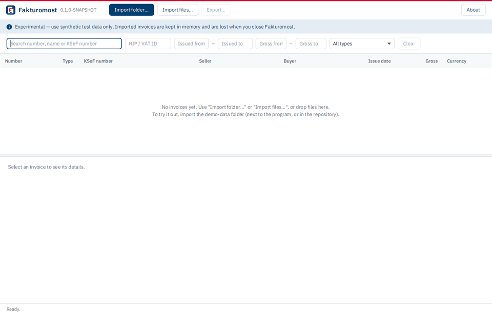
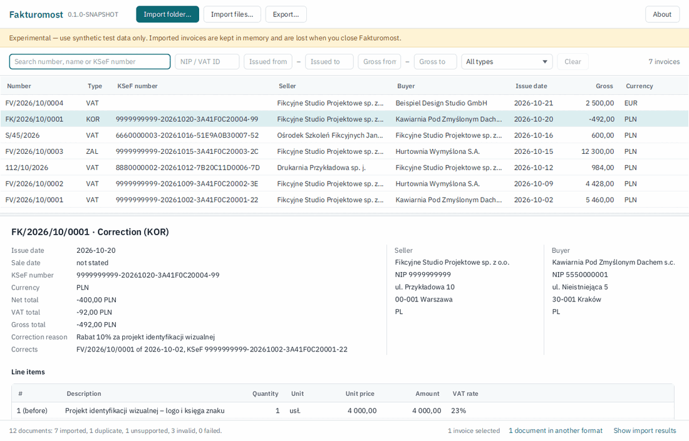
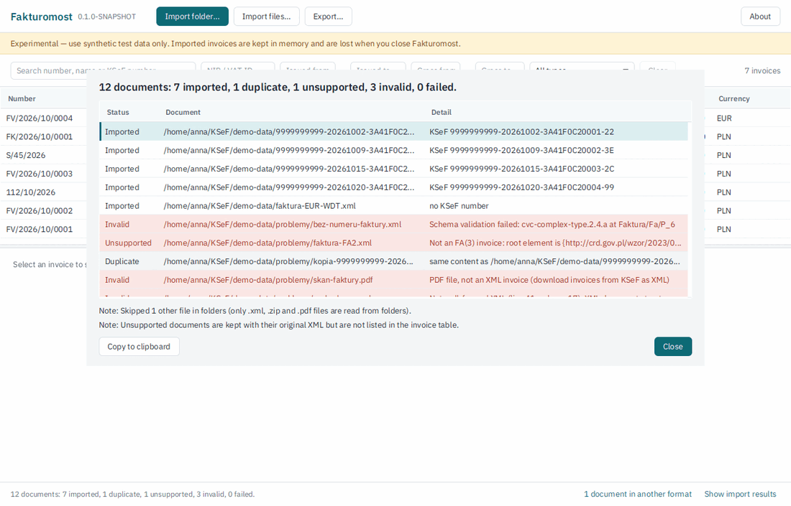
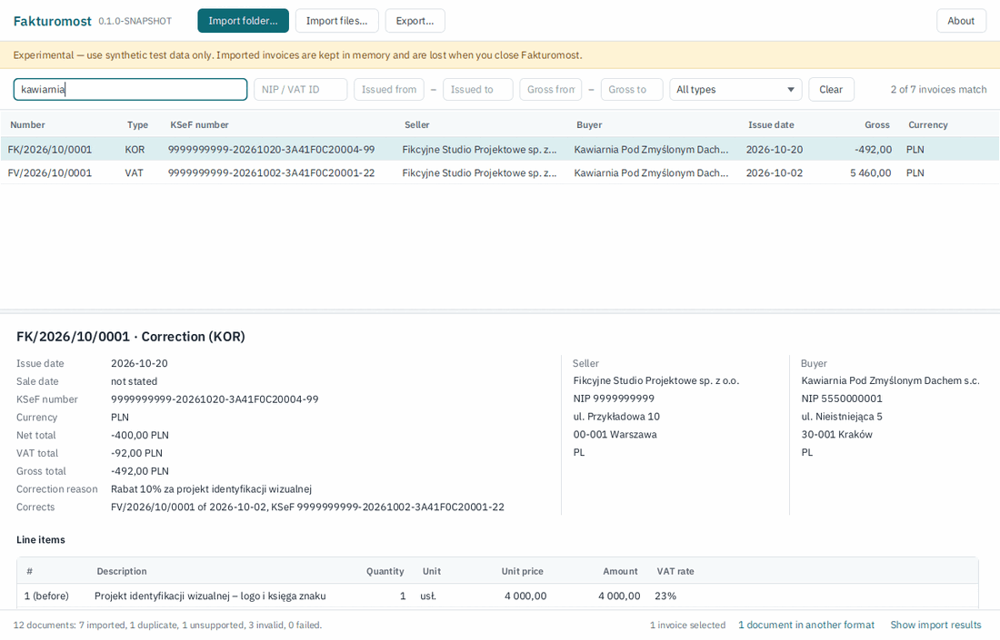
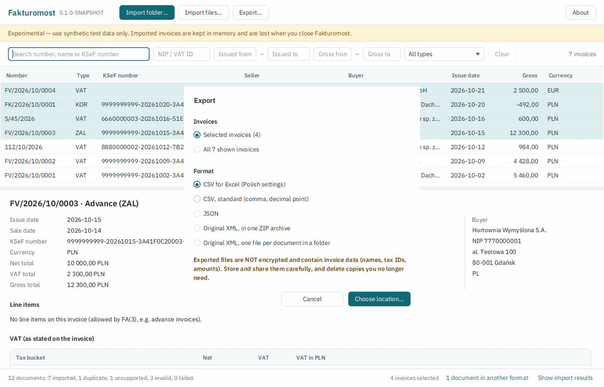
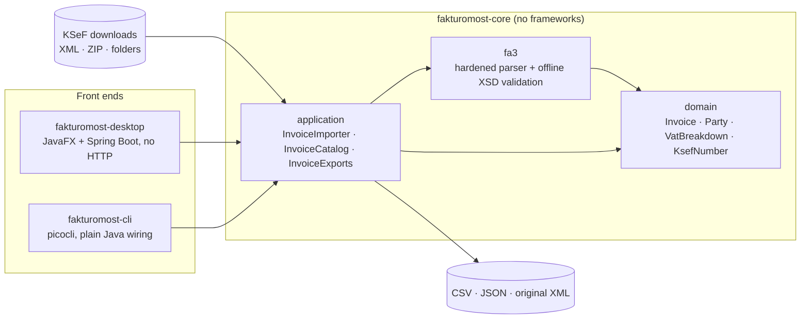
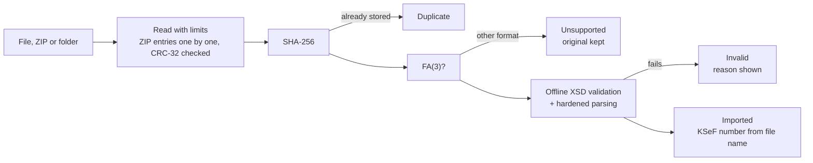

<div align="center">


# Fakturomost

**A local, private bridge between KSeF and your business software.**<br>
Open-source desktop app and CLI to import, browse, validate and export Polish **KSeF FA(3) e-invoices** (XML/ZIP) to **CSV, Excel, JSON** or the original XML — offline, on your own computer.

[](https://github.com/michalraczkowski/fakturomost/actions/workflows/ci.yml)
[](LICENSE)


[Features](#features) · [Download](#download) · [Build from source](#quick-start-from-source) · [CLI](#command-line-tool) · [Exports](#export-formats) · [Security](#security-and-privacy) · [Architecture](#architecture) · [Roadmap](#roadmap) · [Po polsku](#po-polsku)



<sub>Import a folder of KSeF downloads → see what was imported and why something was rejected → browse and search → export the selection to CSV for Excel. Demo data is fully synthetic.</sub>

</div>

> [!WARNING]
> **Experimental, not for production financial data yet.** Fakturomost is an independent open-source project, **not affiliated with or endorsed by the Polish Ministry of Finance**. In the current version imported invoices are kept **in memory only**; encrypted local storage is the next milestone. Please use the bundled synthetic demo data or KSeF **test** environment invoices.

---

## Why Fakturomost?

Since KSeF (*Krajowy System e-Faktur*, Poland's National e-Invoicing System) became the channel for invoices, every invoice exists as a structured **FA(3) XML** document. The free Ministry tools let you download them — as single XML files or as a ZIP package — but many small businesses still work with **older inventory, sales or bookkeeping software that cannot read KSeF XML**.

Fakturomost sits between the two:

1. **Download** your invoices from KSeF as XML or a ZIP package (e.g. from the taxpayer application *Aplikacja Podatnika KSeF*).
2. **Import** the files or the whole folder into Fakturomost.
3. **Browse, search and check** them in a clear table with full invoice details.
4. **Export** exactly the invoices you need to **CSV (ready for Excel with Polish settings)**, **JSON**, or as **original, unchanged XML**.

Everything happens **locally**. Fakturomost has no server, no account, no telemetry, and does not connect to KSeF in this version.

## Features

What works today (see the [roadmap](#roadmap) for what's next):

**Import**
- 📥 KSeF **FA(3)** invoices as single **XML files**, **ZIP packages** (KSeF bulk downloads) or **whole folders** (searched recursively); drag & drop supported
- ✅ Every document is validated against the **official FA(3) XML schema**, bundled and checked **offline**
- 🔁 **Duplicate detection** by SHA-256 of the original bytes — re-downloading overlapping date ranges is safe
- 🧾 The **KSeF number** is taken from the KSeF file name and verified (format, date, CRC-8 checksum, seller NIP)
- 📋 A clear **import report**: every document is *Imported*, *Duplicate*, *Unsupported* (e.g. older FA(2)), *Invalid* (with the reason) or *Failed* — nothing is dropped silently
- ⏹️ Long imports run in the background and can be **cancelled**

**Browse**
- 🔎 **Search and filters**: invoice number, seller/buyer name, KSeF number, **NIP / EU VAT number**, **issue date range**, **gross amount range**, invoice type (VAT, correction, advance, …)
- 📄 **Invoice details**: seller and buyer, dates, line items (including *before correction* rows), **net / VAT per tax rate**, gross total, corrected invoices, original XML size and SHA-256
- 🇵🇱 Amounts exactly as written on the invoice — never rounded or recalculated — in Polish notation (`12 300,00`)

**Export**
- 📊 **CSV for Excel (Polish settings)**: `;` separator, decimal comma, UTF-8 BOM so Polish letters display correctly
- 🧮 **CSV, standard** (RFC 4180 style) and **JSON** (versioned, documented format) for other software and scripts
- ☑️ Export the **selected** invoices or **all invoices the filters show**
- 🗂️ **Original XML**, byte-for-byte unchanged, into one **ZIP** or a **folder** (files named by KSeF number) — also for documents in formats Fakturomost cannot read, such as FA(2)
- 🛡️ **CSV formula-injection protection**, and Fakturomost never overwrites a file without asking

**Also**
- 💻 A scriptable [**command-line tool**](#command-line-tool) with the same engine (`inspect`, `convert`)
- 🎨 A consistent look on every operating system (bundled font, own theme)
- 🧪 A [**synthetic demo dataset**](demo-data/README.md) to try everything without real data

### Screenshots

<table>
  <tr>
    <td width="50%"><br><sub><b>Invoice list and details</b> — a correction invoice with its <i>before</i> rows</sub></td>
    <td width="50%"><br><sub><b>Import report</b> — every document accounted for, problems highlighted</sub></td>
  </tr>
  <tr>
    <td width="50%"><br><sub><b>Search and filters</b> — text, NIP, dates, amounts, type</sub></td>
    <td width="50%"><br><sub><b>Export</b> — selected or all shown invoices, as CSV for Excel, CSV, JSON or original XML</sub></td>
  </tr>
</table>

## Download

Test builds for **Windows** and **Linux** are published on the [Releases](https://github.com/michalraczkowski/fakturomost/releases) page as pre-releases. They are portable: **Java is included**, nothing needs to be installed.

| System | File | How to start |
|---|---|---|
| Windows 10/11 (x64) | `Fakturomost-<version>-windows-x64.zip` | Unzip, run `Fakturomost.exe` |
| Linux (x64, GTK 3 desktop) | `Fakturomost-<version>-linux-x64.tar.gz` | `tar xzf …`, run `Fakturomost/bin/Fakturomost` |

The demo data is included: click **Import folder…** and choose the `demo-data` folder next to the program.

> [!NOTE]
> The builds are not code-signed yet, so Windows SmartScreen may show "Windows protected your PC" — click **More info → Run anyway**. `Fakturomost-console.exe` starts the same app with a console window that shows error messages. A proper installer is planned (see [roadmap](#roadmap)).

## Quick start (from source)

**Requirements:** JDK 21 (e.g. [Eclipse Temurin](https://adoptium.net/)) and Git. Maven is included as the Maven Wrapper. No KSeF account or credentials are needed.

```bash
git clone https://github.com/michalraczkowski/fakturomost.git
cd fakturomost
./mvnw verify                 # Windows: mvnw.cmd verify — builds and runs all tests
```

### Run the desktop app

```bash
./mvnw -q install -DskipTests
./mvnw -q -pl fakturomost-desktop exec:java \
  -Dexec.mainClass=dev.michalraczkowski.fakturomost.desktop.Launcher
```

Or run `dev.michalraczkowski.fakturomost.desktop.Launcher` from your IDE. Then click **Import folder…** and choose the [`demo-data`](demo-data/README.md) folder of this repository.

To build the portable app yourself: `bash packaging/package.sh` after the Maven package step (see the script header). CI does the same for Windows and Linux in [`.github/workflows/package.yml`](.github/workflows/package.yml).

## Command-line tool

The `fakturomost-cli` module runs the same import, validation and export engine without a UI — handy for scripts, scheduled jobs and CI. It is stateless: it reads the inputs, writes one output and exits.

```bash
./mvnw -q -pl fakturomost-cli -am package -DskipTests
java -jar fakturomost-cli/target/fakturomost-cli.jar --help
```

**Check files without writing anything** (`inspect`):

```console
$ java -jar fakturomost-cli/target/fakturomost-cli.jar inspect demo-data
Imported     demo-data/9999999999-20261002-3A41F0C20001-22.xml  [KSeF 9999999999-20261002-3A41F0C20001-22]
Imported     demo-data/9999999999-20261009-3A41F0C20002-3E.xml  [KSeF 9999999999-20261009-3A41F0C20002-3E]
Imported     demo-data/9999999999-20261015-3A41F0C20003-2C.xml  [KSeF 9999999999-20261015-3A41F0C20003-2C]
Imported     demo-data/9999999999-20261020-3A41F0C20004-99.xml  [KSeF 9999999999-20261020-3A41F0C20004-99]
Imported     demo-data/faktura-EUR-WDT.xml  [no KSeF number]
Invalid      demo-data/problemy/bez-numeru-faktury.xml  [Schema validation failed: cvc-complex-type.2.4.a at Faktura/Fa/P_6]
Unsupported  demo-data/problemy/faktura-FA2.xml  [Not an FA(3) invoice: root element is {http://crd.gov.pl/wzor/2023/06/29/12648/}Faktura]
Duplicate    demo-data/problemy/kopia-9999999999-20261009-3A41F0C20002-3E.xml  [same content as demo-data/9999999999-20261009-3A41F0C20002-3E.xml]
Invalid      demo-data/problemy/skan-faktury.pdf  [PDF file, not an XML invoice (download invoices from KSeF as XML)]
Invalid      demo-data/problemy/uszkodzona.xml  [Not well-formed XML (line 41, column 17): XML document structures must start and end within the same entity.]
Imported     demo-data/zakupy-ksef-2026-10.zip!/8880000002-20261012-7B20C11D0006-7D.xml  [KSeF 8880000002-20261012-7B20C11D0006-7D]
Imported     demo-data/zakupy-ksef-2026-10.zip!/6660000003-20261016-51E9A0B30007-52.xml  [KSeF 6660000003-20261016-51E9A0B30007-52]
12 documents: 7 imported, 1 duplicate, 1 unsupported, 3 invalid, 0 failed.
```

**Export with filters** (`convert`) — here: October 2026 invoices of one customer, as CSV for Excel:

```bash
java -jar fakturomost-cli/target/fakturomost-cli.jar convert demo-data \
  --format csv --out faktury-2026-10.csv \
  --from 2026-10-01 --to 2026-10-31 --nip 555-000-00-01
```

| Option | Meaning |
|---|---|
| `--format csv\|json\|xml` | CSV/JSON: one row/object per invoice. `xml`: the original files, unchanged (a folder, or one archive if `--out` ends in `.zip`) |
| `--csv-preset excel-pl\|standard` | `excel-pl` (default): `;`, decimal comma, UTF-8 BOM. `standard`: `,`, decimal point, no BOM |
| `--from`, `--to` | Issue date range, inclusive (`yyyy-mm-dd`) |
| `--nip` | Seller **or** buyer tax ID — NIP or EU VAT number, any notation |
| `--force` | Replace an existing output (never done without it) |

Exit codes for scripts: `0` success · `1` usage error · `2` some documents invalid or unsupported · `3` I/O or unexpected error. Diagnostics go to stderr and never contain invoice contents.

## Export formats

### CSV (one row per invoice)

Columns: KSeF number, invoice number, type, issue date, sale date, seller NIP, seller name, buyer tax ID, buyer name, currency, **net**, **VAT**, **gross**, document ID. Headers are Polish by default:

```csv
Numer KSeF,Numer faktury,Rodzaj faktury,Data wystawienia,Data sprzedaży,NIP sprzedawcy,Nazwa sprzedawcy,Identyfikator nabywcy,Nazwa nabywcy,Waluta,Netto,VAT,Brutto,ID dokumentu
9999999999-20261020-3A41F0C20004-99,FK/2026/10/0001,KOR,2026-10-20,,9999999999,Fikcyjne Studio Projektowe sp. z o.o.,5550000001,Kawiarnia Pod Zmyślonym Dachem s.c.,PLN,-400.00,-92.00,-492.00,b8e29ff2…
```
<sub>The <code>standard</code> preset, shortened. The default <code>excel-pl</code> preset uses <code>;</code> and decimal commas.</sub>

- **Excel (Polish settings)** opens the default preset correctly with a double-click.
- Net and VAT are the sums of the tax buckets **stated on the invoice**; amounts are written as numbers (negative values on corrections stay numbers).
- Text cells starting with `=`, `+`, `-`, `@`, tab or carriage return are prefixed with `'` (CSV/formula-injection protection); numbers are never altered.

### JSON

A versioned document with every field always present (`null` when absent) and decimals exactly as written on the invoice:

```json
{
  "format" : "fakturomost-invoices",
  "formatVersion" : 1,
  "invoices" : [ {
    "ksefNumber" : "9999999999-20261020-3A41F0C20004-99",
    "type" : "KOR",
    "number" : "FK/2026/10/0001",
    "issueDate" : "2026-10-20",
    "currency" : "PLN",
    "seller" : {
      "taxId" : { "type" : "NIP", "countryCode" : "PL", "value" : "9999999999" },
      "name" : "Fikcyjne Studio Projektowe sp. z o.o."
    },
    "vatBreakdown" : [ { "bucket" : "BASIC_RATE", "net" : -400.00, "vat" : -92.00, "vatInPln" : null } ],
    "grossTotal" : -492.00,
    "correctedInvoices" : [ {
      "issueDate" : "2026-10-02",
      "number" : "FV/2026/10/0001",
      "ksefNumber" : "9999999999-20261002-3A41F0C20001-22"
    } ]
  } ]
}
```
<sub>Shortened: the real output also contains the document ID, sale date, buyer, addresses and line items.</sub>

### Original XML

The documents exactly as received from KSeF — byte-for-byte identical — written to a folder (one `<KSeF number>.xml` per invoice) or a single ZIP archive.

> [!IMPORTANT]
> **Exported files are not encrypted.** They contain invoice data (names, tax IDs, amounts). Fakturomost says so before and after every export.

## Security and privacy

Invoices contain business and personal data, so Fakturomost treats every input as untrusted and keeps data local. The threat model is explicit; no software is "completely secure".

**In place today**
- **Local-first:** no server, no account, no telemetry, no KSeF connection. The desktop app runs Spring Boot **without any web server**, enforced three ways: banned dependencies (Maven Enforcer), `WebApplicationType.NONE`, and a test asserting the app opens **no listening sockets**.
- **Hardened XML parsing:** any `DOCTYPE` is rejected (no XXE, no entity expansion); schemas are bundled and resolved from a fixed allow-list, **never from the network**; documents are limited to 10 MiB.
- **Safe ZIP handling:** nothing is ever extracted to disk (no Zip Slip); limits of 10,000 entries and 512 MiB uncompressed are enforced on bytes actually read, not on sizes the archive declares (ZIP bombs); each entry's CRC-32 is verified; nested archives are not opened.
- **Integrity:** originals are kept byte-for-byte; identity is the SHA-256 of the bytes.
- **Log hygiene:** messages and reports contain file names, statuses and rule names — never invoice contents.
- **Architecture rules** (ArchUnit): the core cannot use networking, JDBC, UI toolkits or the console; the UI cannot bypass the application layer.

**Planned** (see [roadmap](#roadmap)): encrypted SQLite storage with the key protected by **Windows DPAPI**, fail-closed when secure storage is unavailable; encrypted backups with a recovery password (Argon2id).

## Architecture

A small hexagonal (ports-and-adapters) design: a **framework-free core** with two front ends that use only its application layer.



How a document is imported:



| Module | Responsibility | Key technology |
|---|---|---|
| [`fakturomost-core`](fakturomost-core) | Domain model, FA(3) parsing and validation, import, search, export | Java 21, JDK XML APIs, Jackson (streaming JSON) |
| [`fakturomost-desktop`](fakturomost-desktop) | Desktop UI; Spring wires the core (no HTTP server) | JavaFX 21, Spring Boot 4 |
| [`fakturomost-cli`](fakturomost-cli) | Stateless `inspect` / `convert` commands | picocli |

Design principles: the core knows nothing about Spring, JavaFX, databases or the OS; front ends talk only to three use-case services; long operations never run on the UI thread; amounts are `BigDecimal` and dates `LocalDate` — never `double`, never locale-dependent parsing.

## Tech stack

| Area | Choice |
|---|---|
| Language / build | Java 21 (LTS), Maven multi-module with Maven Wrapper |
| Desktop | JavaFX 21, Spring Boot 4 (dependency injection only), IBM Plex Sans (bundled) |
| CLI | picocli |
| XML | JDK DOM with hardened settings, official FA(3) XSD validated offline |
| JSON / CSV | Jackson 3 streaming / own RFC 4180 writer with injection protection |
| Tests | JUnit 5, AssertJ, ArchUnit — 340+ automated tests |
| CI | GitHub Actions on **Linux and Windows** |
| Packaging | `jpackage` portable builds with a bundled runtime, built on GitHub Actions (Windows + Linux) |
| Planned | SQLite with encryption, Windows DPAPI, Windows installer |

## Roadmap

| | Milestone | Status |
|---|---|---|
| 1 | Project foundation: modules, Spring without HTTP, CI on Linux + Windows | ✅ Done |
| 2 | Invoice processing: FA(3) parsing, offline XSD validation, XML/ZIP import, dedup, CSV/JSON/XML export | ✅ Done |
| 3 | Command-line tool: `inspect`, `convert` | ✅ Done |
| 4 | Desktop app: import, invoice table, details, filters, export | ✅ Done |
| 5 | Secure local storage: encrypted SQLite, DPAPI-protected key, data survives restarts | 🚧 Next up |
| 6 | Windows installer with bundled Java runtime and demo data | 🧪 Portable Windows/Linux builds available; installer planned |
| 7 | Hardening: encrypted backup and restore, threat model, documentation | 📋 Planned |
| 8 | Optional KSeF API synchronization (TEST/DEMO environments only, outside the default build) | 💡 Optional |

Production KSeF connectivity is intentionally out of scope for the public demo.

## Demo data

[`demo-data/`](demo-data/README.md) is one month of a **fictitious** company: 7 FA(3) invoices (sales and purchases, a correction, an advance invoice, a EUR intra-EU supply, a KSeF-style ZIP package) plus deliberately broken files that show every import outcome. All names, NIPs (with invalid checksums) and KSeF numbers are made up; the dataset is checked by a test on every build.

## FAQ

**Is this an official Ministry of Finance application?**<br>
No. Fakturomost is independent and not affiliated with or endorsed by the Polish Ministry of Finance. "KSeF" is used only to describe compatibility.

**Does Fakturomost send my invoices anywhere?**<br>
No. It has no server and no telemetry, and it does not connect to KSeF in this version. A test checks that the desktop app opens no network listeners.

**Can I use it for my company's real invoices?**<br>
Not yet. The current version keeps data in memory and is meant for evaluation with synthetic or KSeF test-environment data. Encrypted storage and backups come first.

**Which invoice formats are supported?**<br>
KSeF **FA(3)** (schema `1-0E`). Other formats such as FA(2) or FA_RR are reported as *Unsupported* and kept unchanged: the desktop app lists them under "documents in another format" and can export their original XML. PDF visualisations are rejected with a hint to download XML.

**Where does the KSeF number come from?**<br>
It is not inside the invoice XML. KSeF names downloaded files after it, so Fakturomost reads it from the file name and accepts it only if the format, date, checksum and seller NIP all match.

**Does it replace accounting software?**<br>
No. It is a bridge: it gets invoices out of KSeF files into formats your existing software can read.

## Contributing

Issues and suggestions are welcome — especially real-world feedback on KSeF downloads (file layouts, edge cases) and on CSV/Excel import into other software. See [CONTRIBUTING.md](CONTRIBUTING.md). Please **never attach real invoices** or credentials; use the demo data or anonymised samples. Security issues: see [SECURITY.md](SECURITY.md).

## Po polsku

**Fakturomost** to darmowa aplikacja open source (desktop + wiersz poleceń) do **importu, przeglądania, wyszukiwania i eksportu faktur ustrukturyzowanych z KSeF** w formacie **FA(3)**. Wczytuje pliki XML, **paczki ZIP pobrane z KSeF** i całe foldery, sprawdza je z oficjalnym schematem XSD (offline), wykrywa duplikaty i odczytuje numer KSeF z nazwy pliku. Wybrane faktury można wyeksportować do **CSV dla Excela (polskie ustawienia: średnik, przecinek dziesiętny)**, **JSON** lub jako **niezmienione oryginalne pliki XML** — np. żeby wczytać je do starszego programu magazynowego lub księgowego, który nie obsługuje KSeF.

Wszystko działa **lokalnie na Twoim komputerze** — bez serwera, bez konta i bez wysyłania danych. Projekt jest **eksperymentalny**, niezależny i **niepowiązany z Ministerstwem Finansów**; obecna wersja nie jest przeznaczona do prawdziwych danych finansowych (dane są trzymane w pamięci). Do testów służą dołączone [fikcyjne dane demonstracyjne](demo-data/README.md).

## License and disclaimer

Licensed under the [Apache License 2.0](LICENSE). Copyright © 2026 Michał Raczkowski.

Fakturomost is an independent, experimental open-source project. It is not affiliated with or endorsed by the Polish Ministry of Finance. The software is provided under the Apache License 2.0 on an "AS IS" basis, without warranties, to the extent permitted by applicable law. The current version is intended for demonstration and testing purposes and is not designed for production financial data. Users should independently verify exported information and maintain appropriate backups. Fakturomost does not replace professional accounting software or accounting advice.

**Third-party components:** the official FA(3) XML schemas are bundled from [CIRFMF/ksef-docs](https://github.com/CIRFMF/ksef-docs) (MIT License, © Ministerstwo Finansów); [IBM Plex Sans](https://github.com/IBM/plex) is bundled under the SIL Open Font License 1.1; other dependencies are listed in the Maven POMs with their own licenses.
